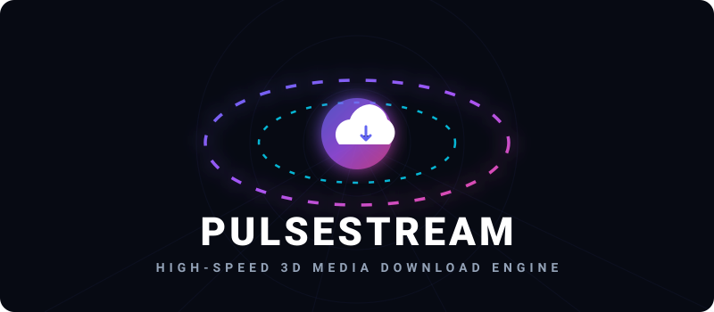

<p align="center">
  
</p>

<p align="center">
  <strong>Next-Generation Media Extraction & 4K Stream Muxing Platform</strong>
</p>

<p align="center">
  <a href="https://github.com/isitanand/pulsestream/stargazers"></a>
  <a href="https://github.com/isitanand/pulsestream/network/members"></a>
  <a href="https://github.com/isitanand/pulsestream/blob/main/LICENSE"></a>
  <a href="https://react.dev/"></a>
  <a href="https://vitejs.dev/"></a>
  <a href="https://tailwindcss.com/"></a>
  <a href="https://nodejs.org/"></a>
</p>

<p align="center">
  
</p>

---

## 🌟 Overview

**PulseStream** is an ultra-fast, privacy-first web application engineered for high-fidelity media extraction and stream muxing. Powered by a modern React 19 frontend and an Express/Node.js backend integrated with `yt-dlp` and `FFmpeg`, PulseStream effortlessly analyzes, extracts, merges, and delivers 4K/60FPS video and lossless 320kbps audio from over **1,000+ streaming sites** with zero advertisements and zero tracking.

---

## ✨ Key Highlights

- 🎨 **Award-Winning Design System**: Built with bespoke typography pairings (**Instrument Serif**, **Manrope**, **Cabin**, and **Inter**), fluid motion, and glassmorphic floating elements.
- 🌓 **Adaptive Light & Dark Modes**: Light Theme set as primary default with persistent user preference memory.
- 🎯 **Symmetrical Capsule Navigation**: Floating pill navbar with responsive dropdown menus and quick access to download history, stream preferences, and developer profile.
- 🎬 **Dynamic Resolution Selector**: Intelligently parses standard aspect ratios and widescreen cinematic streams (1080p, 720p, 480p, 360p) with one-click quality presets.
- 🎛️ **Real-Time FFmpeg Muxer**: Downloads separate high-bitrate video streams and lossless audio tracks, merging them in background child workers on the fly.
- ⚙️ **Stream Engine Settings**: Granular control over default media format, resolution preference, audio bitrate (320kbps/256kbps/128kbps), clipboard auto-analyze, and incognito mode.
- 🛡️ **Enterprise-Grade Rate Limiting & Auto Cleanup**: Background sweepers continuously purge temporary chunk files every 10 minutes, preventing server bloat and safeguarding user privacy.

---

## 🏗️ System Architecture

```
[ User Browser ]
       │
       ▼  (React 19 + Tailwind CSS)
[ PulseStream Client ] ──(POST /api/metadata)───────┐
       │                                            │
       ▼  (POST /api/download/prepare)              ▼
[ Express.js API Gateway ] ──────────────► [ Worker Queue ]
       │                                            │
       ├─► Node.js Runtime Check                    ▼
       └─► yt-dlp Metadata Extraction ◄── [ Child Process Worker ]
                                                    │
                 ┌──────────────────────────────────┴──────────────────┐
                 ▼                                                     ▼
     [ Video Stream (4K/1080p/720p) ]                     [ Audio Track (Opus/AAC) ]
                 │                                                     │
                 └───────────────► [ FFmpeg Muxing Engine ] ◄──────────┘
                                              │
                                              ▼ (Combined MP4 / Lossless MP3)
                                  [ Temp Storage (/downloads/temp) ]
                                              │
                                              ▼ (GET /api/download/file/:id)
                                  [ Direct File Transfer & Auto-Sweep ]
```

---

## 🌐 Universal Platform Coverage

PulseStream supports over 1,000+ platforms out-of-the-box:

| Platform | Supported Formats | Max Fidelity | Highlights |
| :--- | :--- | :--- | :--- |
| **YouTube** | Shorts, Playlists, VODs | **4K / 60FPS** | Node.js challenge solver, stream muxing |
| **TikTok** | Videos, Audio clips | **1080p HD** | Clean lossless MP4 without watermarks |
| **Instagram** | Reels, Stories, Posts | **Original 1080p** | Fast single-clip capture |
| **SoundCloud** | Tracks, Sets, Podcasts | **320kbps MP3** | Hi-Fi bitrate extraction & conversion |
| **Twitter / X** | Video clips, GIFs | **1080p HD** | Instant CDN bypass and capture |
| **Vimeo** | Pro Streams, Showcases | **4K Ultra HD** | Direct master stream fetching |
| **Twitch** | Clips & VODs | **1080p 60FPS** | Fast chunk streaming |

---

## 📂 Project Directory Structure

```
pulsestream/
├── client/                     # Frontend Application (React 19, Vite, Tailwind CSS)
│   ├── src/
│   │   ├── components/         # Hero, Downloader, SettingsModal, DeveloperModal, Features
│   │   ├── services/           # API fetch client & job status handlers
│   │   ├── pages/              # Downloader main view
│   │   ├── index.css           # Custom fonts, Tailwind styles & glassmorphic themes
│   │   └── App.jsx             # Main state orchestration (Theme, History, Preferences)
│   ├── package.json
│   └── vite.config.js
│
├── server/                     # Backend Processing Engine (Node.js, Express)
│   ├── bin/                    # FFmpeg & FFprobe binary location
│   ├── src/
│   │   ├── controllers/        # Metadata & download preparation controllers
│   │   ├── middleware/         # Security headers (Helmet), CORS, and Rate Limiting
│   │   ├── services/           # ytDlp execution wrapper & active jobs worker
│   │   └── server.js           # Server bootstrap & cleanup sweepers
│   ├── package.json
│   └── render-build.sh         # Deployment setup script
│
├── shared/                     # Shared constants and error codes
│   └── constants/constants.json
└── README.md
```

---

## ⚡ Quick Start & Local Setup

### 1. Prerequisites
- **Node.js** (v18.0.0 or higher)
- **Python** (v3.9 or higher, with `yt-dlp` installed via `python -m pip install yt-dlp`)
- **FFmpeg** (installed and added to system PATH, or placed in `server/bin`)

### 2. Clone the Repository
```bash
git clone https://github.com/isitanand/pulsestream.git
cd pulsestream
```

### 3. Install All Dependencies
```bash
npm run setup
```
*(This installs root, frontend client, and backend server dependencies in one command).*

### 4. Configure Environment Variables
Create a `.env` file inside the `server/` directory:
```env
PORT=5000
NODE_ENV=development
CLIENT_URL=http://localhost:5173
DOWNLOAD_DIR=downloads/temp
CLEANUP_INTERVAL_MS=300000
FILE_LIFETIME_MS=600000
RATE_LIMIT_MAX=100
```

### 5. Launch the Development Server
```bash
npm run dev
```

- **Frontend Client**: [http://localhost:5173](http://localhost:5173)
- **Backend API**: [http://localhost:5000](http://localhost:5000)

---

## 📡 REST API Documentation

### 1. Analyze Media URL
Extracts video metadata, available resolutions, author details, and thumbnails.
```http
POST /api/metadata
Content-Type: application/json

{
  "url": "https://youtu.be/8yLG-lW_r_g"
}
```

### 2. Prepare Download Job
Queues a background job to download and mux the requested format.
```http
POST /api/download/prepare
Content-Type: application/json

{
  "url": "https://youtu.be/8yLG-lW_r_g",
  "formatId": "232",
  "type": "video",
  "title": "Backstreet Boys - I Still"
}
```

### 3. Check Job Status
Polls active progress, download speed, ETA, and muxing stage.
```http
GET /api/download/status/:jobId
```

### 4. Fetch Completed File
Directly downloads the finished `.mp4` or `.mp3` file and schedules temporary cleanup.
```http
GET /api/download/file/:jobId
```

### 5. Cancel Job
Terminates active worker child processes and deletes intermediate chunk files.
```http
POST /api/download/cancel/:jobId
```

---

## 🚀 Deployment Guide

### Deploying Frontend to Vercel
1. Link your repository at [vercel.com/new](https://vercel.com/new).
2. Set **Root Directory** to `client`.
3. Set **Framework Preset** to `Vite`.
4. Add Environment Variable:
   - `VITE_API_URL` = `https://your-backend-api.onrender.com/api`
5. Click **Deploy**!

### Deploying Backend to Render / Railway
1. Create a new **Web Service** on [Render](https://render.com) or [Railway](https://railway.app).
2. Set Build Command: `bash server/render-build.sh`
3. Set Start Command: `npm start --prefix server`
4. Set Environment Variables:
   - `PORT` = `5000`
   - `CLIENT_URL` = `https://your-app.vercel.app`

---

## 👨‍💻 Architect & Developer

<div align="center">

  ### **Anand Choubey**
  *Full-Stack Developer & Software Engineer*  
  📍 Delhi NCR, India

  <p>
    <em>"Crafting high-performance streaming architectures, scalable backends, and elegant web experiences."</em>
  </p>

  <p align="center">
    <a href="https://linkedin.com/in/anand-choubey-979b17326">
      
    </a>
    &nbsp;
    <a href="https://github.com/isitanand">
      
    </a>
    &nbsp;
    <a href="https://anandchoubey.is-a.dev">
      
    </a>
    &nbsp;
    <a href="mailto:anandchoubey2005@gmail.com">
      
    </a>
  </p>

</div>

---

## ⚖️ License & Disclaimer

This project is licensed under the **MIT License**.

> **Disclaimer**: PulseStream is developed for educational and research purposes only. Users are solely responsible for ensuring compliance with copyright laws and the terms of service of each respective media platform.
